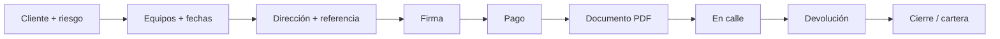

<p align="center">
  
</p>

# ARCHITECTURE — HYEDA

Arquitectura del sistema de gestión de alquileres de **Herramientas y Equipos del Ariari** (Granada, Meta).

---

## Visión

HYEDA es una aplicación **modular monolítica** en backend (Spring Boot) con **SPA** en frontend (React). Cada dominio de negocio vive en su propio paquete Java y se expone bajo `/api/...`. El frontend organiza la operación como un **centro de control del patio**, no como un CRUD genérico.

```text
┌──────────────────────────────────────────────────────────┐
│  Frontend (React 19 · Vite · Tailwind · Framer Motion)   │
│  Hoy · Alquileres · Clientes · Patio · Caja · Sistema    │
└──────────────────────────┬───────────────────────────────┘
                           │ HTTPS / JSON + JWT
┌──────────────────────────▼───────────────────────────────┐
│  Backend Spring Boot 4.1 · puerto 8081                   │
│  Security (JWT) → Controllers → Services → JPA           │
└──────────┬───────────────┬───────────────┬───────────────┘
           │               │               │
      H2 / Postgres   storage/PDF     Integraciones
                                        (WhatsApp, Maps…)
```

---

## Capas backend

Paquete base: `co.edu.uniminuto.hyeda`

Arquitectura hexagonal ligera: cada dominio expone servicios y controladores; las integraciones entran por puertos (`WhatsAppPort`, `PaymentGatewayPort`, `BackgroundCheckPort`).

| Paquete | Utilidad |
| --- | --- |
| `iam` | Login, JWT + refresh, usuarios, roles, permisos |
| `catalog` | Inventario, ledger, reservas con `SELECT FOR UPDATE` |
| `crm` | Clientes, reputacion, antecedentes, ficha 360 |
| `rental` | Maquina de estados, PricingService, wizard |
| `documents` | PDF Thymeleaf, numeracion, QR |
| `billing` | Pagos, deudas, saldo a favor |
| `finance` | Libro de caja y cartera |
| `notifications` | Outbox WhatsApp |
| `analytics` | Tablero y reportes |
| `imports` | CSV/Excel con previsualizacion |
| `integrations` | Adaptadores reales/simulados |
| `shared` | Money, auditoria, storage, empresa |

---

## Flujo principal: alquiler



1. **RESERVADO** — se reserva stock con expiración.
2. **DOCUMENTO_EMITIDO** — PDF generado.
3. **EN_CURSO** — equipo en obra (dirección + nombre de referencia).
4. **DEVUELTO** → facturación final / pendiente de pago → **CERRADO**.

La ubicación de obra se modela como texto operativo (`deliveryReference` + `deliveryAddress`). Las columnas lat/lng pueden existir por compatibilidad, pero **la UX no depende de coordenadas**.

---

## Frontend: arquitectura de UI

```text
src/
├── brand/          # Logo HEA + BrandLockup
├── components/     # Layout, Toast, SlideOver, Overlay, CommandPalette
├── modules/        # Páginas por dominio operativo
├── services/       # Axios + auth token
└── types/          # Contratos TypeScript alineados al API
```

Patrones clave:
- **Query cache** (TanStack Query) para listas y dashboard.
- **Drawers** para gestionar un alquiler/cliente sin abandonar el hub.
- **Command Palette** para navegación rápida.
- Redirects de rutas legacy hacia la nueva IA (`/sistema?tab=…`, etc.).

---

## Datos

- Dev: H2 file `./data/hyeda` en modo PostgreSQL. Flyway obligatorio (`ddl-auto=none`).
- Prod: perfil `postgres`.
- Tests: H2 en memoria.
- Archivos: `backend/storage/` (PDFs, evidencias, copias de documento) — **no versionados**.

Migraciones: `backend/src/main/resources/db/migration/`. Esquema de referencia: [`docs/schema-hyeda-v2.sql`](docs/schema-hyeda-v2.sql).

---

## Integraciones

Detalle en [`docs/INTEGRACIONES.md`](docs/INTEGRACIONES.md).

| Integración | Estado típico en lab |
| --- | --- |
| WhatsApp | Adapter mock (log) |
| Maps | Búsqueda por texto de dirección/referencia |
| Antecedentes | Registro + evidencia PDF |
| Pagos QR | Referencia operativa / preparación Wompi |

---

## Decisiones de diseño

1. **Monolito modular** — entrega académica ágil sin microservicios prematuros.
2. **Operación sobre CRUD** — pantallas nombradas por el trabajo del patio.
3. **Dirección humana** — referencia + dirección reflejan cómo se habla en Granada/Ariari.
4. **PDF como soporte** — documentos generados son evidencia operativa, no solo “export”.
5. **RBAC** — permisos listos para separar caja, patio y administración.

---

<p align="center">
  <sub>HYEDA Architecture · HEA · Granada, Meta</sub>
</p>
