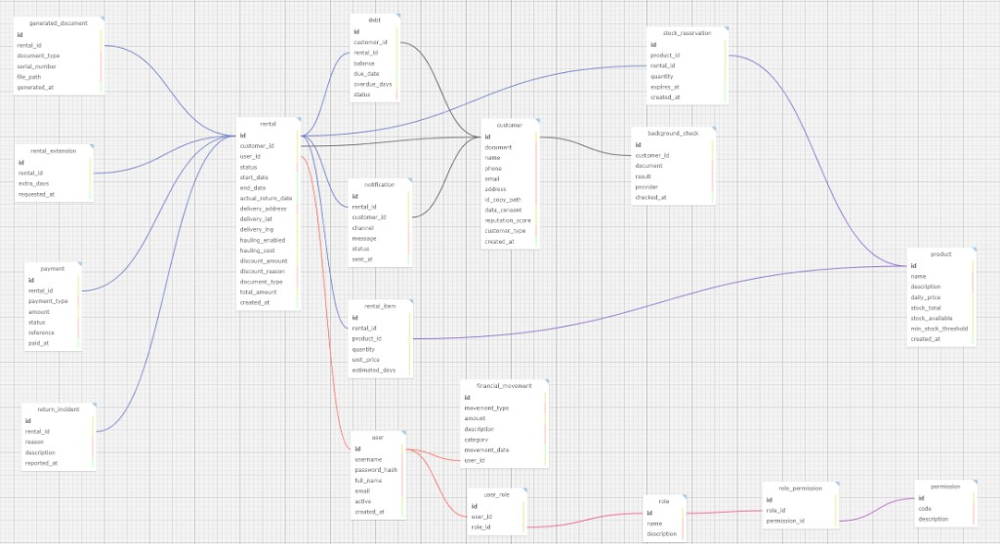
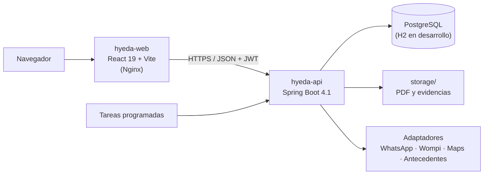

<div align="center">
  
  <h1>HYEDA</h1>
  <p><b>Sistema de gestión de alquiler de herramientas y maquinaria</b><br/>Desarrollado para Herramientas y Equipos del Ariari (Granada, Meta)</p>

  

  <br/><br/>

  
  
  
  
  
  
  [](LICENSE)

  <p>
    <a href="ARCHITECTURE.md">Arquitectura</a> ·
    <a href="SECURITY.md">Seguridad</a> ·
    <a href="docs/INTEGRACIONES.md">Integraciones</a> ·
    <a href="CHANGELOG.md">Changelog</a>
  </p>
</div>

<details>
<summary><b>English summary</b></summary>

HYEDA is a rental management system for a tool and light-machinery rental business in Granada (Meta, Colombia). It covers the full rental lifecycle: customers and risk checks, inventory with time-limited stock reservations, a four-step rental wizard with on-screen signature, payments (cash, QR, partial payments), PDF documents (contract, delivery note, return note, invoice), debts, cash movements and a daily dashboard.

It is a modular Spring Boot 4.1 monolith (Java 26, JPA, Spring Security with JWT and permission-based RBAC, OpenHTMLToPDF, Apache POI) with a React 19 + Vite + TanStack Query SPA, deployable to Render with Docker. It was built as an academic project for a Spring Boot / frameworks course at UNIMINUTO.
</details>

## Qué es

HYEDA es el sistema con el que se lleva el control del patio de un negocio de alquiler de herramientas y maquinaria liviana para construcción. El negocio manejaba los alquileres en talonarios de papel (contrato, remisión y devolución), el inventario en Excel y las cuentas en archivos dispersos, lo que hacía difícil saber qué equipo estaba alquilado y a quién se había entregado. Con HYEDA cada alquiler queda registrado desde que se reserva el equipo hasta que se devuelve y se cobra.

La aplicación responde a las preguntas que se hacen todos los días en el negocio:

| Necesidad del negocio | Qué resuelve HYEDA |
| --- | --- |
| ¿Quién tiene el equipo? | Alquileres en calle, estados y asistente de apertura |
| ¿A dónde va la obra? | Dirección más nombre de referencia, sin depender de coordenadas |
| ¿Quién debe? | Cartera, abonos, pagos en efectivo o QR |
| ¿Qué falta en el patio? | Inventario con stock disponible, stock reservado y umbral mínimo |
| ¿Papelería? | Contrato, remisión, devolución y factura en PDF |
| ¿Riesgo del cliente? | Registro de antecedentes con evidencia y puntaje de reputación |

La interfaz está pensada para el mostrador: pocos clics, paneles laterales para gestionar un alquiler o un cliente sin salir de la lista, paleta de comandos (`Ctrl+K`) y un flujo guiado de cuatro pasos para abrir un alquiler.

## Funcionalidades

| Módulo | Qué hace |
| --- | --- |
| **Hoy** (dashboard) | KPIs del día, cola operativa, obras activas y gráfica de ingresos (Recharts) |
| **Alquileres** | Asistente de 4 pasos (cliente y riesgo → equipos, fechas y obra → firma en pantalla → pago y aviso por WhatsApp), extensiones, devolución con incidencias y cierre |
| **Clientes** | CRM, consentimiento de tratamiento de datos, copia de documento, reputación y antecedentes |
| **Patio** (inventario) | Productos con tarifa diaria, stock total y disponible, alertas por umbral mínimo |
| **Caja** (finanzas) | Movimientos de ingreso y gasto, deudas y su vencimiento |
| **Documentos** | Generación y consulta de PDF: contrato, remisión, devolución y factura |
| **Sistema** | Usuarios, roles y permisos; importación desde DOCX/XLSX; estado de integraciones |
| **Analítica** | Exportación a Excel y reporte diario en PDF generado por tarea programada |

Un alquiler pasa por los estados `BORRADOR`, `RESERVADO`, `DOCUMENTO_EMITIDO`, `EN_CURSO`, `DEVUELTO`, `FACTURACION_FINAL`, `PENDIENTE_PAGO`, `CERRADO` o `CANCELADO`.

## Capturas

Modelo relacional de la base de datos (también disponible el esquema en [`docs/schema-hyeda-v2.sql`](docs/schema-hyeda-v2.sql)):

<p align="center">
  
</p>

Los PDF que genera el sistema se diseñaron a partir de los formatos físicos que el negocio ya usaba (contrato de arrendamiento, remisión y devolución).

## Arquitectura



- **Monolito modular.** Cada dominio (`auth`, `clientes`, `inventario`, `alquileres`, `facturacion`, `documentos`, `finanzas`, `analytics`, `importacion`, `integraciones`) vive en su paquete bajo `co.edu.uniminuto.hyeda.modules` con su controlador, servicio, repositorio, entidades y DTO.
- **Seguridad sin estado.** Login con JWT (jjwt) y autorización por permisos con `@PreAuthorize`. Se siembran nueve permisos y dos roles: `ADMIN` (todos) y `EMPLEADO` (inventario, alquileres, clientes, facturación y documentos).
- **Reserva de stock con expiración.** Al abrir un alquiler se reserva el stock durante 30 minutos (configurable); un job cada 5 minutos libera las reservas vencidas y un bloqueo por producto evita reservas simultáneas sobre el mismo equipo.
- **Integraciones detrás de adaptadores.** WhatsApp, pagos QR (Wompi) y antecedentes funcionan en modo simulado por defecto y se activan con variables de entorno. Detalle en [`docs/INTEGRACIONES.md`](docs/INTEGRACIONES.md).
- **Tareas programadas.** Expiración de reservas, actualización diaria de deudas vencidas y reporte diario en PDF.
- **Listo para Render.** El backend convierte automáticamente URLs `postgres://` a JDBC y agrega `sslmode=require` cuando se usa la URL externa.

La descripción completa de capas, módulos y flujo del alquiler está en [`ARCHITECTURE.md`](ARCHITECTURE.md).

## Stack tecnológico

| Capa | Tecnología |
| --- | --- |
| Backend | Java 26, Spring Boot 4.1.1 (Web, Data JPA, Security, Validation) |
| Autenticación | JWT (jjwt 0.12.6), RBAC por permisos |
| Mapeo | MapStruct 1.6.3, Lombok |
| Documentos | OpenHTMLToPDF 1.0.10 (PDF), Apache POI 5.4.0 (Excel y DOCX) |
| Base de datos | H2 en desarrollo, PostgreSQL en producción |
| Frontend | React 19, TypeScript 6, Vite 8, React Router 7 |
| Estado y datos | TanStack Query 5, Axios |
| UI | Tailwind CSS 4, Framer Motion, Recharts |
| Despliegue | Docker (multi-stage), Nginx, Render Blueprint |

## Puesta en marcha

### Requisitos

- JDK 26 (el proyecto incluye Maven Wrapper)
- Node.js 22 y npm
- PostgreSQL solo si quieres usar el perfil `postgres`; por defecto se usa H2 en archivo

### Backend

```bash
cd backend
./mvnw spring-boot:run
# Windows: .\mvnw.cmd spring-boot:run
```

- API en `http://localhost:8081/api`.
- Perfil por defecto: `dev` (H2 en `./data/hyeda`, consola en `/h2-console`).
- Para PostgreSQL: `./mvnw spring-boot:run -Dspring-boot.run.profiles=postgres`.

Al arrancar se crea el usuario administrador definido por `HYEDA_ADMIN_USER` (por defecto `admin`) con la contraseña de `HYEDA_ADMIN_PASS`. Define esa variable antes del primer arranque; el valor por defecto de desarrollo está en `application.properties` y no debe usarse fuera de tu máquina.

### Frontend

```bash
cd frontend
npm install
cp .env.example .env
npm run dev
```

La interfaz queda en `http://localhost:5173`. Otros scripts: `npm run build`, `npm run lint` (oxlint) y `npm run preview`.

### Variables de entorno

| Variable | Uso |
| --- | --- |
| `PORT` | Puerto del API (por defecto 8081) |
| `SPRING_PROFILES_ACTIVE` | `dev` (H2) o `postgres` |
| `SPRING_DATASOURCE_URL` / `_USERNAME` / `_PASSWORD` | Conexión a PostgreSQL |
| `HYEDA_JWT_SECRET` | Clave de firma de los JWT |
| `HYEDA_ADMIN_USER` / `HYEDA_ADMIN_PASS` | Usuario administrador inicial |
| `HYEDA_CORS_ORIGINS` | Orígenes permitidos, separados por coma |
| `HYEDA_STORAGE` | Carpeta de PDF y evidencias |
| `WHATSAPP_TOKEN`, `WHATSAPP_PHONE_NUMBER_ID`, `WHATSAPP_ADMIN_PHONE` | WhatsApp Cloud API |
| `WOMPI_PUBLIC_KEY`, `WOMPI_PRIVATE_KEY`, `WOMPI_INTEGRITY_KEY` | Pagos QR |
| `GOOGLE_MAPS_API_KEY` | Mapas |
| `BACKGROUND_CHECK_API_KEY` | Proveedor comercial de antecedentes |
| `VITE_API_URL` | URL del API para el frontend (en build) |

Las recomendaciones de manejo de secretos están en [`SECURITY.md`](SECURITY.md).

## Pruebas

El backend tiene una prueba de arranque del contexto de Spring:

```bash
cd backend
./mvnw test
```

## API

| Prefijo | Descripción |
| --- | --- |
| `/api/auth` | Login JWT, usuario actual y health check |
| `/api/admin` | Usuarios, roles y permisos |
| `/api/clientes` | CRM |
| `/api/productos` | Inventario |
| `/api/alquileres` | Ciclo de vida del alquiler |
| `/api/pagos` | Efectivo, QR y abonos |
| `/api/documentos` | PDF |
| `/api/finanzas` | Movimientos y deudas |
| `/api/analytics` | Dashboard y exportación a Excel |
| `/api/importacion` | Carga desde DOCX/XLSX |
| `/api/antecedentes` | Consulta y evidencia |
| `/api/integraciones` | Notificaciones y estado de integraciones |

## Despliegue

El repositorio incluye un Dockerfile por servicio y un Blueprint [`render.yaml`](render.yaml) para el plan gratuito de Render (región Virginia):

| Servicio | Dockerfile | Rol |
| --- | --- | --- |
| `hyeda-api` | [`backend/Dockerfile`](backend/Dockerfile) | Spring Boot con perfil `postgres`, health check en `/api/auth/health` |
| `hyeda-web` | [`frontend/Dockerfile`](frontend/Dockerfile) | Build de Vite servido por Nginx |

El Blueprint no crea una base de datos nueva: usa una PostgreSQL existente. Durante la sincronización se piden `SPRING_DATASOURCE_URL`, `SPRING_DATASOURCE_USERNAME`, `SPRING_DATASOURCE_PASSWORD`, `HYEDA_ADMIN_PASS` y `HYEDA_CORS_ORIGINS`; `HYEDA_JWT_SECRET` se genera automáticamente. `VITE_API_URL` debe apuntar a la URL real del API.

Para probar las imágenes localmente:

```bash
# API (requiere una PostgreSQL accesible)
cd backend
docker build -t hyeda-api .
docker run --rm -p 8081:8081 \
  -e PORT=8081 \
  -e SPRING_DATASOURCE_URL=jdbc:postgresql://host.docker.internal:5432/hyeda \
  -e SPRING_DATASOURCE_USERNAME=<usuario> \
  -e SPRING_DATASOURCE_PASSWORD=<clave> \
  -e HYEDA_ADMIN_PASS=<clave-admin> \
  -e HYEDA_CORS_ORIGINS=http://localhost:* \
  hyeda-api

# Frontend
cd frontend
docker build --build-arg VITE_API_URL=http://localhost:8081/api -t hyeda-web .
docker run --rm -p 8080:80 hyeda-web
```

En el plan gratuito el servicio se suspende por inactividad y la carpeta `storage/` es efímera, así que los PDF generados se pierden en cada redespliegue.

## Estructura del repositorio

```text
HYEDA/
├── assets/          # Logo HEA y banner
├── backend/         # API Spring Boot (puerto 8081)
│   └── src/main/java/co/edu/uniminuto/hyeda/
│       ├── config/      # Seguridad, JWT, CORS, jobs, datasource
│       ├── modules/     # Un paquete por dominio
│       └── shared/      # Excepciones y utilidades
├── frontend/        # SPA React (puerto 5173)
│   └── src/{brand,components,modules,services,types}
├── docs/            # Esquema SQL, modelo relacional, integraciones y entregables
├── render.yaml      # Blueprint de Render
├── ARCHITECTURE.md
├── CHANGELOG.md
└── SECURITY.md
```

La rama `main` contiene la versión 1.1 descrita en este documento. La rama `v2` contiene una reescritura del sistema con backend reorganizado por dominios (catálogo, facturación, analítica) y un frontend reconstruido; todavía no se ha integrado a `main`.

## Documentación

- [`ARCHITECTURE.md`](ARCHITECTURE.md): capas, módulos, flujo del alquiler y decisiones de diseño.
- [`SECURITY.md`](SECURITY.md): autenticación, secretos y checklist antes de desplegar.
- [`docs/INTEGRACIONES.md`](docs/INTEGRACIONES.md): pasos para activar WhatsApp, Wompi, Google Maps y antecedentes.
- [`docs/schema-hyeda-v2.sql`](docs/schema-hyeda-v2.sql): esquema de referencia de la base de datos.
- [`docs/Diseño del proyecto (1).pdf`](<docs/Diseño del proyecto (1).pdf>): enunciado de la actividad de diseño (caso de uso y modelo entidad-relación).
- [`CHANGELOG.md`](CHANGELOG.md): historial de versiones.

## Autoría

<table>
  <tr>
    <td align="center"><a href="https://github.com/Joan-Mora"><br/><b>Darwin Joan Aveiga Mora</b></a><br/><sub>Análisis, diseño y desarrollo full stack (rama <code>main</code>), despliegue</sub></td>
    <td align="center"><a href="https://github.com/MrRoar154"><br/><b>Julian Esteban Chavez Zamora</b></a><br/><sub>Coautor, reescritura v2 (rama <code>v2</code>)</sub></td>
  </tr>
</table>

Desarrollado para Herramientas y Equipos del Ariari (Granada, Meta). Proyecto académico de la asignatura Frameworks (Spring Boot), programa Tecnología en Desarrollo de Software, UNIMINUTO.

## Licencia

Copyright © 2026 Darwin Joan Aveiga Mora y Julian Esteban Chavez Zamora. **Todos los derechos reservados.**

Este repositorio es público para que el código pueda consultarse como parte de mi portafolio. Eso no concede permiso para copiarlo, reutilizarlo, modificarlo, distribuirlo ni presentarlo como trabajo propio. Los términos completos están en [`LICENSE`](LICENSE). Para cualquier uso, escribe a [darwin@abacore.co](mailto:darwin@abacore.co).

<div align="center">
<sub>Hecho por <a href="https://github.com/Joan-Mora">Darwin Aveiga</a> · <a href="https://abacore.co">Abacore S.A.S.</a></sub>
</div>
